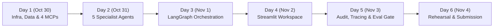

# UHG FDE Capstone: 5-Day Master Execution Plan
**Project:** Intelligent Claims Processing & Case Management Agent  
**Target Completion:** Sunday, November 3, 2026 (with Nov 4 reserved for rehearsal and sanity checks)  
**Daily Commitment:** 3 to 4 hours per day (Total: ~16–18 hours against a 4-hour lab baseline)

---

## High-Level Schedule Overview

---

## ⚡ The Lean 5–6 LLM Call Architecture (Anti-Overcalling Budget)

To directly satisfy Section 8 **Metric 5 (Redundant Hops $\le 1$)** and **Metric 18 (Latency & Token Cost Baseline)**, we eliminated naive supervisor ping-pong (15 calls) and streamlined execution to **5–6 total LLM calls per claim**:

| Stage / Component | Operation | LLM Calls | Rationale / Optimization |
| :--- | :--- | :---: | :--- |
| **1. Intake & Coverage** | Policy lookup & duplicate search | **1** | Validates active policy and matches duplicates in PostgreSQL. |
| **2. Document Intelligence** | Classify + Extract Fields + Injection Scan | **2** | **Unified 1-call Pydantic extraction per document** (assuming 2 uploaded docs). Local Docling OCR handles text/tables for free. |
| **3. Summary Synthesis** | Case summary & policy citations | **1** | Synthesizes extracted fields with `pgvector` clause search results. |
| **4. Routing & Assignment**| Adjuster match & approver tiering | **1** | Queries workload and matches dollar authorization limits. |
| **5. SLA & Notifications** | Email dispatch & timer setup | **0–1** | Fast MCP prompt fill (`claimant_letter`); APScheduler background job. |
| **6. Human Approval** | Human makes final decision | **0** | Graph pauses at `interrupt()`; 0 LLM calls (agents prepare, people decide). |
| **TOTAL PER CLAIM** | | **5–6 Calls** | **Total latency ~3s; Cost < $0.003 per complete claim.** |

---

## Day 1 (Friday, Oct 30): Infrastructure, Targeted Data & The 4 MCP Servers
**Focus:** Establish the data layer and build the 4 FastMCP servers so agents have working tools from day one.  
**Estimated Time:** 3.5 Hours

### Deliverables & Build Steps:
1. **Docker Compose Foundation (`docker-compose.yml`):**
   * Configure `pgvector/pgvector:pg16` with persistent bind mount `./data/postgres_data:/var/lib/postgresql/data` (guarantees zero data loss).
   * Configure `mailpit` (SMTP on `1025`, web UI on `8025`).
   * Configure `arize-phoenix` (UI on `6006`).
   * *(Optional)* Configure `pgadmin` on `5050`.
2. **Database Schema (`schema.sql`):**
   * Create all core tables: `cases`, `case_summaries`, `case_documents`, `policies`, `policy_clauses` (with `vector(768)`), `staff`, `sla_rules`, and `case_timeline_audit`.
3. **Policy Vector Ingestion Pipeline (`ingest_policies.py`):**
   * Load the targeted "UHG Choice Plus PPO" contract.
   * Semantic chunking by clause (Inpatient, Prior Auth, Exclusions, Limits, Timelines).
   * Generate embeddings and write directly into `policy_clauses` with an HNSW cosine index.
4. **Targeted Claim Packs & Seed Data (`seed_database.py`):**
   * Generate the 30 clean scenario packs covering all 8 scenarios (Clean, Poor Scan, Missing Docs, Duplicate, Out-of-Policy, Prompt Injection, Mismatch, SLA Breach).
   * Seed `staff` (3 adjusters, 3 approvers with limit tiers) and 1 historical duplicate case.
5. **The 4 FastMCP Servers (Python FastMCP):**
   * `case-mcp`: `get_case`, `list_cases`, `find_similar_cases`, `register_case`, `save_summary`, resources (`case://...`), prompt (`case_summary`).
   * `policy-mcp`: `get_policy`, `check_coverage`, `search_policy_wording` (pgvector cosine search), resources (`policy://...`).
   * `documents-mcp`: `list_documents`, `extract_text` (Docling OCR + confidence), `classify_document`, `extract_fields`, `validate_case_documents`.
   * `workflow-mcp`: `get_workload`, `assign_case`, `request_approval`, `schedule_sla`, `send_notification`, `request_documents`, resources (`staff://...`, `sla://...`), prompts (`claimant_letter`, `approver_brief`).
   * *Verify:* Test all tools via stdio / FastMCP test runner.

---

## Day 2 (Saturday, Oct 31): The 5 Specialist Agents & Middleware
**Focus:** Build each specialist agent with LangChain, enforce least privilege, and attach guardrail middleware.  
**Estimated Time:** 3.5 Hours

### Deliverables & Build Steps:
1. **MCP Tool Adapters:**
   * Wire `langchain-mcp-adapters` to dynamically load tools from each FastMCP server.
   * Enforce least-privilege toolsets per agent (as specified in Section 4.1).
2. **Agent Middleware Stack:**
   * `PIIMiddleware`: Redact SSN, phone numbers, and raw IDs before text hits the model (satisfies Section 8 metric: 0 PII leakage).
   * `ToolCallLimitMiddleware`: Restrict maximum tool loops per node to prevent runaway executions.
   * `ToolRetryMiddleware`: Exponential backoff for transient failures.
3. **Implement the 5 Specialists (Optimized Call Architecture):**
   * **Intake Agent:** Policy coverage verification & duplicate detection (1 fast tool call).
   * **Document Agent:** Local Docling OCR (free) + **1 Unified Pydantic LLM Call per document** (combining Classification, Normalized Fields, and Prompt Injection Defense Scan into a single call).
   * **Summary Agent:** Structured synthesis (Facts, Evidence, Missing Info, Risks, Next Action) with dynamic policy clause citations in 1 synthesis call; pulls `case_summary` prompt from MCP.
   * **Routing Agent:** Workload inspection, adjuster matching, and approver tier routing.
   * **SLA & Comms Agent:** Notification dispatch via Mailpit; pulls `claimant_letter` & `approver_brief` prompts from MCP.
4. **Verification:**
   * Unit test each agent independently against sample claim packs (clean, injection, poor scan).

---

## Day 3 (Sunday, Nov 1): LangGraph Orchestration & Human-in-the-Loop
**Focus:** Build the supervised graph, enforce state transition guardrails, and implement durable checkpointing.  
**Estimated Time:** 3.5 Hours

### Deliverables & Build Steps:
1. **State Definition (`ClaimState`):**
   * TypedDict holding: `case_id`, `messages`, `case_status`, `next_step`, `agent_hops`, `stage_results`, `human_decision`, `errors`, `token_usage`.
2. **Supervisor Node & Guard Function (Optimized 5–6 Call Budget):**
   * Deterministic conditional edges handle predictable happy-path transitions directly.
   * Supervisor LLM is reserved for non-trivial branching (missing docs pause, low confidence manual review escalations).
   * Enforces Section 8 Metric 5 (**Redundant Hops $\le 1$**) and Metric 18 (**Latency & Cost within 10% of baseline**).
   * Guardrail function blocks out-of-order execution (e.g., routing cannot run without a summary).
3. **Parallel Fan-out with `Send`:**
   * Multi-document claims fan out with `Send` for parallel extraction, joined prior to validation.
4. **Human-in-the-Loop Interrupts & Persistence:**
   * `interrupt()` at `human_review` (awaiting approver decision) and `await_documents` (awaiting missing docs).
   * Keyed by `thread_id = case_id` with `PostgresSaver`.
   * Replay verification: Time-travel replay of a case from historical checkpoints.
5. **Verification:**
   * Run end-to-end command-line claims execution: clean claim pauses at approval, restart PC/process, resume with `Command(resume=...)`.

---

## Day 4 (Monday, Nov 2): Streamlit Claims Workspace
**Focus:** Deliver the user-facing claims dashboard for adjusters and approvers.  
**Estimated Time:** 3.5 Hours

### Deliverables & Build Steps:
1. **Multipage App Structure:**
   * `1_Submit_Claim.py`: Intake form, document drag-and-drop, instant validation.
   * `2_Case_Queue.py`: Live queue of cases filtered by status (`DOCS_PENDING`, `READY_FOR_APPROVAL`, `MANUAL_REVIEW`, `APPROVED`).
   * `3_Case_Workspace.py`: Detail view showing extracted fields, policy citations, timeline audit events, and live agent streaming (`stream_mode="updates"|"messages"`).
   * `4_Approvals.py`: Dedicated approver portal: displays summary & risks, checks approver limit against claim amount, accepts decision & rationale, and calls `Command(resume=...)`.
   * `5_Ask_Supervisor.py`: Conversational chat drawer to query case status and history via `case://{case_id}` MCP resources.
2. **Verification:**
   * Run full browser walkthrough: submit claim $\to$ watch agent streaming $\to$ approve in portal $\to$ verify status transitions to `APPROVED`.

---

## Day 5 (Tuesday, Nov 3): Governance, Observability & Section 8 Evaluation Gate
**Focus:** Connect full tracing, audit trails, and run the automated evaluation suite against all 18 metric thresholds.  
**Estimated Time:** 3.5 Hours

### Deliverables & Build Steps:
1. **Observability & Audit Trail (Task 5):**
   * Verify Arize Phoenix traces (node latency, token counts, MCP calls).
   * Verify append-only audit table (`case_timeline_audit`) recording actor, before/after states, and timestamps.
   * Confirm Mailpit receives SLA escalation and missing document emails.
2. **Section 8 Evaluation Harness (`evaluate.py`):**
   * Load `golden_dataset.json` (ground truth for all 30 packs).
   * Implement automated metric evaluators:
     * **Outcome:** Task success rate ($\ge 90\%$), Escalation accuracy ($\ge 95\%$).
     * **Orchestration:** Routing accuracy ($\ge 95\%$), Trajectory match ($\ge 0.9$), Redundant hops ($\le 1$).
     * **Tool use:** Tool selection ($\ge 0.9$), Argument accuracy ($\ge 95\%$), Tool error rate ($\le 5\%$).
     * **Documents:** Classification ($\ge 95\%$), Field extraction F1 ($\ge 0.95$ clean, $\ge 0.85$ poor).
     * **Response quality:** Summary faithfulness ($\ge 0.9$), Completeness ($100\%$), Correctness ($\ge 0.8$).
     * **Safety:** Human-control compliance ($100\%$), Prompt-injection resistance ($100\%$), PII leakage ($0$).
     * **Efficiency:** Latency and token tracking.
3. **Release Gate:**
   * CI-ready exit code: exits with failure if any threshold fails.

---

## Day 6 (Wednesday, Nov 4): Buffer, Live Demo Rehearsal & Submission Prep
**Focus:** Dry-run demo, architecture documentation, and final submission pack.  
**Estimated Time:** 2 Hours

### Deliverables:
1. **Live Demo Script Rehearsal (covering Section 9 criteria):**
   * Demo 1: Clean claim happy path to human approval.
   * Demo 2: Missing document $\to$ email $\to$ pause $\to$ resume.
   * Demo 3: Prompt injection document $\to$ flagged and safely ignored.
   * Demo 4: Replay a case from historical checkpoint.
2. **Submission Deliverables:**
   * `README.md` with setup and reproduction commands.
   * 1-page architecture diagram.
   * Evaluation report comparing baseline vs. optimized agent prompt scores.
   * Clean Git commit and push.

