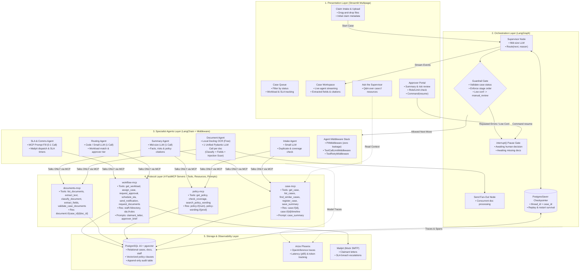

# System Architecture Diagram: Intelligent Claims Processing & Case Management Agent
**Project:** UHG FDE Capstone Project  
**Author:** FDE Capstone Team  
**Scope:** Multi-agent orchestration, MCP server protocol layer, human-in-the-loop gating, and persistence.

---

## 1. End-to-End System Architecture

---

## 2. Key Architecture Principles Enforced

### A. The Golden Rule: "Agents Prepare, People Decide"
* **No Approve Tool:** Notice that in `workflow-mcp`, there is intentionally **no** tool to approve, reject, or settle a claim.
* **LangGraph `interrupt()`:** Execution physically pauses at `HITL_Pause`.
* **Resume via Authorized Token:** Only the Streamlit Approver Portal (`UI_Approval`), after verifying the approver's tier limit, issues a `Command(resume=...)` to finalize the claim.

### B. Protocol Boundary (MCP Only)
* **Zero Direct Agent Chat:** Specialist agents cannot communicate directly with each other. All inter-agent data passing occurs by reading/writing to PostgreSQL through the 4 FastMCP servers.
* **Least Privilege:** Each agent is scoped strictly to its permitted MCP toolset.

### C. Zero Data Loss & Checkpoint Persistence
* State is persisted into PostgreSQL via `PostgresSaver` keyed by `thread_id = case_id`.
* Cases can remain paused for human approval for days, survive complete container restarts, and be replayed from historical checkpoints for compliance audits.

### D. Lean 5–6 LLM Call Budget (Anti-Overcalling Architecture)
* **Single Unified Document Call:** Classification, field extraction, date/amount normalization, and prompt injection detection are executed in **one single Pydantic LLM call per document**.
* **Zero Supervisor Ping-Pong:** LangGraph conditional edges handle predictable hand-offs deterministically; the Supervisor LLM is reserved for genuine branching decisions (missing documents, manual review escalations).
* **Section 8 Compliance:** Directly passes Metric 5 (**Redundant Hops $\le 1$ per case**) and Metric 18 (**Latency & Cost within 10% of baseline**).
