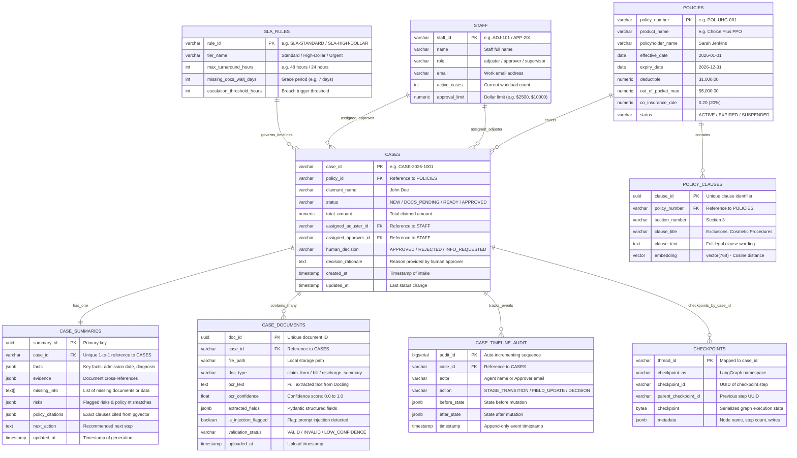

# Database Entity-Relationship (ER) Diagram: Intelligent Claims System
**Project:** UHG FDE Capstone Project  
**Database Engine:** PostgreSQL 16 with `pgvector` Extension  
**Storage Architecture:** Persistent Host Bind-Mount (`./data/postgres_data`)

---

## 1. Entity-Relationship Diagram

---

## 2. Table Data Dictionary & Design Purpose

| Table Name | Primary Key | Foreign Keys | Purpose & Design Rationale |
| :--- | :--- | :--- | :--- |
| **`POLICIES`** | `policy_number` | None | Master policy registry. Stores policyholder details, effective date range, and deductible rules. Used by `policy-mcp: get_policy` and `check_coverage`. |
| **`POLICY_CLAUSES`** | `clause_id` | `policy_number` | Stores clause-by-clause legal text and vector embeddings (`vector(768)`). Enables cosine similarity search ($\iff$) via `policy-mcp: search_policy_wording` for accurate policy citations. |
| **`CASES`** | `case_id` | `policy_id`, `assigned_adjuster_id`, `assigned_approver_id` | Master claim lifecycle record. Tracks status transitions, assigned staff, and final human decisions. Serves as the thread anchor for LangGraph persistence. |
| **`CASE_SUMMARIES`** | `summary_id` | `case_id` (Unique 1:1) | Stores structured AI-generated case summaries (facts, risks, evidence, policy clauses). Read by human approvers in Streamlit before decisioning. |
| **`CASE_DOCUMENTS`** | `doc_id` | `case_id` | Stores raw files, Docling OCR text, layout data, OCR confidence scores, and structured Pydantic fields. Flags malicious prompt injection attempts. |
| **`STAFF`** | `staff_id` | None | Workforce directory. Stores adjuster active case counts (for round-robin workload balancing) and approver authorization dollar limits. |
| **`CASE_TIMELINE_AUDIT`** | `audit_id` | `case_id` | Append-only audit trail. Records every MCP tool mutation, stage transition, and human decision with before/after state snapshots for compliance and replay. |
| **`SLA_RULES`** | `rule_id` | None | SLA matrix defining max turnaround times and escalation thresholds. Exposes the `sla://rules` MCP resource. |
| **`CHECKPOINTS`** | `thread_id, checkpoint_id` | `thread_id` $\to$ `case_id` | LangGraph native persistence table managed by `PostgresSaver`. Stores graph snapshots so paused claims can survive server restarts and resume via `Command(resume=...)`. |
