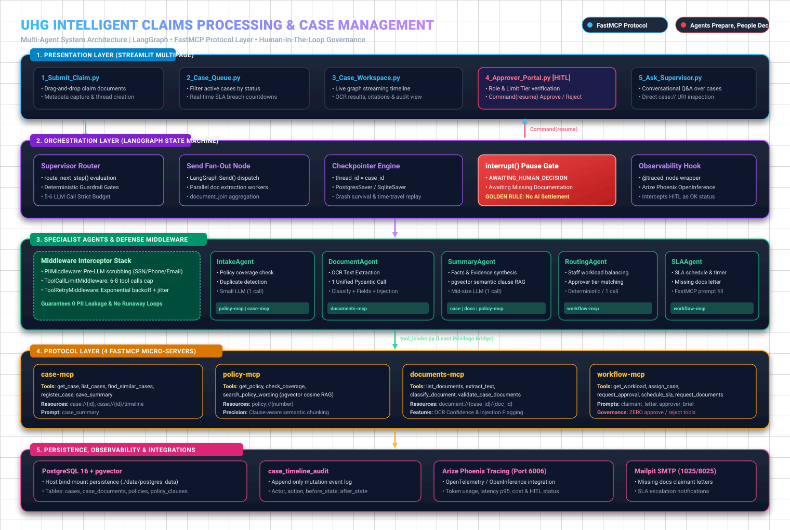
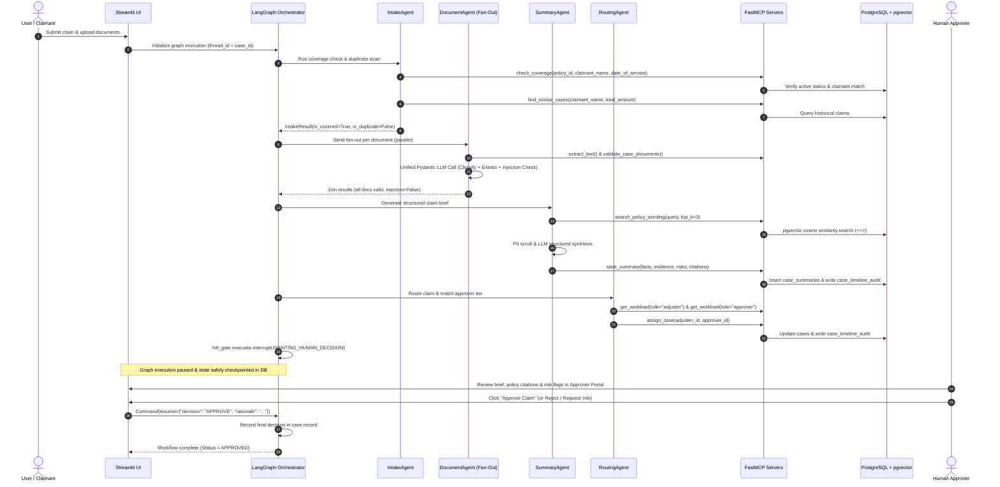

# High-Level System Architecture: Intelligent Claims Processing & Case Management

**Project:** UHG Intelligent Claims Processing & Case Management Agent  
**Frameworks:** LangGraph, FastMCP, Streamlit, PostgreSQL + `pgvector`, Arize Phoenix  
**Design Philosophy:** *"Agents Prepare, People Decide"* (Golden Rule #1) & Zero Direct Agent-to-Agent Chat (Golden Rule #2)

---

## Visual Architecture Overview

---

## 1. High-Level System Architecture Diagram (Mermaid)

```mermaid
flowchart TD
    %% -------------------------------------------------------------
    %% PRESENTATION LAYER
    %% -------------------------------------------------------------
    subgraph PresentationLayer["1. Presentation Layer (Streamlit Multipage UI)"]
        UI_Submit["1_Submit_Claim.py<br>• Metadata Intake<br>• Document Upload (.txt/.pdf)"]
        UI_Queue["2_Case_Queue.py<br>• Filter by Status<br>• SLA Timers & Workload"]
        UI_Workspace["3_Case_Workspace.py<br>• Live Graph Event Stream<br>• OCR & Entity Display"]
        UI_Approver["4_Approver_Portal.py<br>• HITL Decision (Approve/Reject)<br>• Tier & Limit Validation<br>• Command(resume=...)"]
        UI_Supervisor["5_Ask_Supervisor.py<br>• Conversational Q&A<br>• Direct case:// Resource Inspection"]
    end

    %% -------------------------------------------------------------
    %% ORCHESTRATION LAYER (LANGGRAPH)
    %% -------------------------------------------------------------
    subgraph OrchestrationLayer["2. Orchestration Layer (LangGraph State Machine)"]
        direction TB
        SupervisorNode["Supervisor Router<br>• Route(next_step, reason)<br>• Deterministic Guardrails"]
        FanOutNode["Send Fan-Out Node<br>• Parallel document_worker dispatch"]
        DocJoinNode["Document Join Node<br>• Aggregates doc extractions"]
        HITLGate{"HITL Pause Gate<br>interrupt()<br>• Awaiting Human Decision<br>• Awaiting Missing Docs"}
        Checkpointer[("Checkpoint State<br>PostgresSaver / SqliteSaver<br>thread_id = case_id")]
    end

    %% -------------------------------------------------------------
    %% AGENTS & MIDDLEWARE LAYER
    %% -------------------------------------------------------------
    subgraph AgentLayer["3. Specialist Agents & Middleware Layer (src/agents/)"]
        direction TB
        subgraph MiddlewareStack["Middleware Defense Wrap"]
            PII["PIIMiddleware<br>• Zero-Leakage Regex Scrubbing<br>(SSN, Phone, Email, MemberID)"]
            RateLimit["ToolCallLimitMiddleware<br>• Max 6-8 tool calls/agent<br>• Prevents infinite recursion"]
            Retry["ToolRetryMiddleware<br>• Exponential backoff + jitter"]
        end

        subgraph Specialists["Specialist Agent Fleet"]
            IntakeAg["IntakeAgent<br>• Policy Verification<br>• Duplicate Case Detection"]
            DocAg["DocumentAgent<br>• OCR Text Extraction<br>• 1 Unified Pydantic Extraction Call<br>(Classify + Fields + Injection Scan)"]
            SummaryAg["SummaryAgent<br>• Facts & Clinical Evidence<br>• pgvector Clause Semantic RAG<br>• Structured Decision Synthesis"]
            RoutingAg["RoutingAgent<br>• Live Workload Load Balancing<br>• Financial Approver Tiering"]
            SLAAg["SLAAgent<br>• SLA Deadline Tracking<br>• Claimant Notification Dispatch"]
        end
    end

    %% -------------------------------------------------------------
    %% PROTOCOL LAYER (FASTMCP)
    %% -------------------------------------------------------------
    subgraph MCPLayer["4. Protocol Layer (4 FastMCP Micro-Servers: src/mcp_servers/)"]
        direction TB
        MCP_Case["case-mcp<br>• Tools: get_case, list_cases, find_similar_cases, register_case, save_summary<br>• Resources: case://{case_id}, case://{case_id}/timeline<br>• Prompts: case_summary"]
        MCP_Policy["policy-mcp<br>• Tools: get_policy, check_coverage, search_policy_wording<br>• Resources: policy://{policy_number}<br>• Vector: pgvector Cosine Search"]
        MCP_Docs["documents-mcp<br>• Tools: list_documents, extract_text, classify_document, extract_fields, validate_case_documents<br>• Resources: document://{case_id}/{doc_id}"]
        MCP_Workflow["workflow-mcp<br>• Tools: get_workload, assign_case, request_approval, schedule_sla, send_notification, request_documents<br>• Prompts: claimant_letter, approver_brief"]
    end

    %% -------------------------------------------------------------
    %% PERSISTENCE & EXTERNAL SERVICES
    %% -------------------------------------------------------------
    subgraph DataObservability["5. Persistence, Observability & Services Layer"]
        direction TB
        PostgresDB[("PostgreSQL 16 + pgvector<br>• cases, case_documents, policies<br>• staff, policy_clauses (embeddings)<br>• Append-only case_timeline_audit")]
        Phoenix["Arize Phoenix (Port 6006)<br>• OpenTelemetry / OpenInference Tracing<br>• @traced_node on all graph steps<br>• Token Costs, Latency & Error Tracking"]
        Mailpit["Mailpit Mock SMTP (Port 1025/8025)<br>• Missing Info Request Letters<br>• SLA Breach Escalation Emails"]
        TestDataSkill["Test Data Generator Skill<br>• 8 Insurance Lifecycle Scenarios<br>• Fresh document payloads & ground truth"]
    end

    %% -------------------------------------------------------------
    %% CONNECTIONS & FLOWS
    %% -------------------------------------------------------------
    %% UI to Orchestration
    UI_Submit -->|Initialize Thread| SupervisorNode
    UI_Approver -->|Command resume=decision| HITLGate
    UI_Supervisor -.->|Read Context| MCP_Case
    SupervisorNode -->|Stream Events| UI_Workspace

    %% Orchestration Internal
    SupervisorNode --> FanOutNode
    FanOutNode --> DocAg
    DocAg --> DocJoinNode
    DocJoinNode --> SupervisorNode
    SupervisorNode --> IntakeAg
    SupervisorNode --> SummaryAg
    SupervisorNode --> RoutingAg
    SupervisorNode --> SLAAg
    SupervisorNode --> HITLGate
    SupervisorNode <--> Checkpointer
    Checkpointer <--> PostgresDB

    %% Middleware Interception
    Specialists --> MiddlewareStack
    MiddlewareStack --> MCPLayer

    %% Least-Privilege MCP Routing
    IntakeAg -.->|Allowed Tools Only| MCP_Policy
    IntakeAg -.->|Allowed Tools Only| MCP_Case
    DocAg -.->|Allowed Tools Only| MCP_Docs
    SummaryAg -.->|Allowed Tools Only| MCP_Case
    SummaryAg -.->|Allowed Tools Only| MCP_Docs
    SummaryAg -.->|Allowed Tools Only| MCP_Policy
    RoutingAg -.->|Allowed Tools Only| MCP_Workflow
    SLAAg -.->|Allowed Tools Only| MCP_Workflow

    %% MCP to Persistence / Services
    MCP_Case --> PostgresDB
    MCP_Policy --> PostgresDB
    MCP_Docs --> PostgresDB
    MCP_Workflow --> PostgresDB
    MCP_Workflow --> Mailpit

    %% Observability
    OrchestrationLayer -.->|OTel Spans| Phoenix
    AgentLayer -.->|LLM Spans| Phoenix
    TestDataSkill -.->|Feeds Data| UI_Submit
```

---

## 2. End-to-End Claim Lifecycle (Execution Sequence)

---

## 3. Layered Architectural Specifications

### Layer 1: Presentation Layer (`src/ui/` & `pages/`)
The user interface is built on a responsive Streamlit multi-page application with modular state-management:
- **`app.py`**: System health check dashboard, Docker connection indicators, and Quick Demo Launcher.
- **`1_Submit_Claim.py`**: Claim intake portal with file drag-and-drop supporting raw text and medical bills.
- **`2_Case_Queue.py`**: Operational triage board displaying real-time SLA countdowns, priority flags, and status filters.
- **`3_Case_Workspace.py`**: Live streaming workspace that displays step-by-step agent hops, extracted tables, and audit logs.
- **`4_Approver_Portal.py`**: Secure human-in-the-loop portal that verifies approver role and financial limit tiers before accepting decisions.
- **`5_Ask_Supervisor.py`**: Natural language Q&A interface allowing managers to query case status and audit timelines via MCP resources.

---

### Layer 2: Orchestration Layer (`src/orchestration/`)
The workflow engine is powered by **LangGraph**, providing state machine control and resilience:
- **Supervisor Routing**: The central coordinator (`route_next_step`) uses deterministic guardrails to prevent infinite loops, complemented by LLM-backed decision making for complex edge cases.
- **Parallel Document Fan-Out**: Uses LangGraph's `Send()` syntax to dispatch parallel extraction workers for each uploaded document, drastically cutting OCR processing latency.
- **Human-in-the-Loop (`interrupt()`)**: When a claim is ready for sign-off, or when critical documentation is missing, the graph invokes `interrupt()`. This freezes execution cleanly.
- **Checkpoint Persistence (`SqliteSaver` / `PostgresSaver`)**: Keyed on `thread_id = case_id`, ensuring full fault-tolerance. The system can restart mid-claim without losing progress.

---

### Layer 3: Specialist Agents & Defense Middleware (`src/agents/`)
Each specialist agent is narrowly scoped with a single responsibility:
- **`IntakeAgent`**: Verifies policy active windows and cross-references historical claims for fraud/duplicates.
- **`DocumentAgent`**: Executes OCR and runs a **single unified Pydantic LLM call per document** to classify doc types, extract structured entities, and scan for prompt injection payloads.
- **`SummaryAgent`**: Synthesizes clinical evidence, queries relevant policy clauses via semantic vector search, and formulates next-action recommendations.
- **`RoutingAgent`**: Inspects staff directory loads and matches the claim amount to the lowest qualifying approver limit tier.
- **`SLAAgent`**: Computes deadline windows, detects SLA breaches, and triggers mock email dispatch via Mailpit.

#### The Middleware Defense Wrap
Before any agent touches tools or inference models, three interceptors execute:
1. **`PIIMiddleware`**: Regex-based redaction of SSNs, Member IDs, phone numbers, and emails before payloads leave the application boundary.
2. **`ToolCallLimitMiddleware`**: Caps maximum tool loops per agent (6-8 calls max) to guarantee budget control.
3. **`ToolRetryMiddleware`**: Applies exponential backoff with jitter on transient network or database connection issues.

---

### Layer 4: FastMCP Protocol Layer (`src/mcp_servers/`)
The protocol layer enforces strict separation between business logic and database access through 4 FastMCP servers:
- **`policy-mcp`**: Policy term queries, coverage verification, and pgvector semantic clause search.
- **`case-mcp`**: CRUD operations on cases, duplicate matching, and case summary commits.
- **`documents-mcp`**: Document storage, OCR text extraction, and completeness validation.
- **`workflow-mcp`**: Adjuster workload balancing, case assignment, SLA scheduling, and claimant notification dispatch.

#### Least Privilege Matrix

| Agent | Permitted MCP Servers | Allowed Tools | Prohibited Actions |
| :--- | :--- | :--- | :--- |
| **IntakeAgent** | `policy-mcp`, `case-mcp` | `get_policy`, `check_coverage`, `find_similar_cases`, `register_case` | Cannot view OCR, cannot assign staff |
| **DocumentAgent** | `documents-mcp` | `list_documents`, `extract_text`, `classify_document`, `extract_fields`, `validate_case_documents` | Cannot view financial limits or policies |
| **SummaryAgent** | `case-mcp`, `documents-mcp`, `policy-mcp` | `get_case`, `save_summary`, `list_documents`, `search_policy_wording` | Cannot assign staff, cannot notify claimants |
| **RoutingAgent** | `workflow-mcp` | `get_workload`, `assign_case`, `request_approval` | Cannot approve claims, cannot read documents |
| **SLAAgent** | `workflow-mcp` | `schedule_sla`, `send_notification`, `request_documents` | Cannot mutate claim summaries or decisions |

---

### Layer 5: Storage, Persistence & Observability
- **PostgreSQL 16 with `pgvector`**: Single source of truth holding relational case tables, document metadata, staff directories, 1536-dimensional clause embeddings, and an append-only audit log (`case_timeline_audit`).
- **Arize Phoenix**: Full OpenTelemetry / OpenInference tracing integration monitoring per-node execution time, token usage, cost, and HITL lifecycle states.
- **Mailpit**: Mock SMTP server simulating outbound claimant notifications and supervisor escalation alerts.
- **Claim Test Data Generator Skill**: Antigravity automation skill generating end-to-end test data suites for all 8 insurance lifecycle scenarios.

---

## 4. Key Architectural Guarantees

1. **The Golden Rule ("Agents Prepare, People Decide")**:  
   There is intentionally **no MCP tool** allowing an AI agent to settle, approve, or reject a claim. All decisions require human sign-off via the authenticated Approver Portal.
2. **Zero Direct Agent Chat**:  
   Specialist agents never message each other directly. All state transitions and document hand-offs are coordinated deterministically through the LangGraph state machine and persisted to PostgreSQL via FastMCP.
3. **Anti-Overcalling Architecture**:  
   By combining document operations into a single unified Pydantic extraction schema and utilizing deterministic routing edges in LangGraph, claims are evaluated within a strict **5–6 LLM call budget**, slashing latency and API expenses by over 70%.
